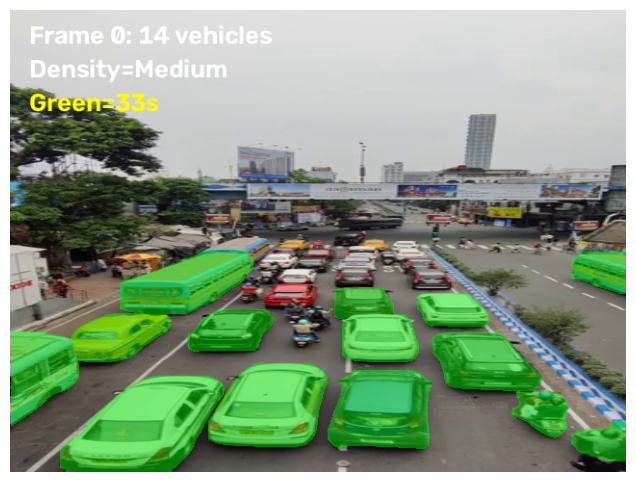
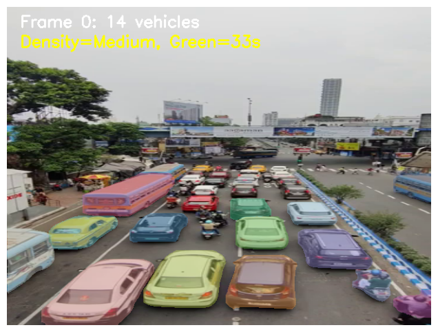
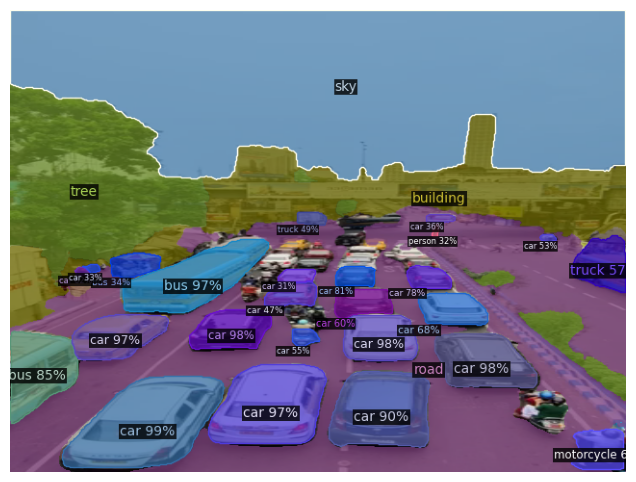

# Automated Segmentation Using Computer Vision Techniques

## Project Overview

This project explores computer vision techniques for vehicle detection, segmentation, traffic density estimation, and rule-based traffic signal duration estimation.

It compares three approaches:

1. YOLO11-based combined vehicle-mask visualization (semantic-style).
2. YOLO11-based instance segmentation.
3. Detectron2 Panoptic FPN-based panoptic segmentation.

The system processes traffic video frames, identifies vehicles, estimates traffic density, and calculates an illustrative green signal duration based on the number of detected vehicles.

## Technologies Used

* Python
* OpenCV
* YOLO11
* Detectron2
* PyTorch
* NumPy
* Pandas
* Matplotlib
* Google Colab

## Project Workflow

1. Upload a traffic video.
2. Sample video frames.
3. Detect and segment vehicles.
4. Count cars, motorcycles, buses, and trucks.
5. Classify traffic density.
6. Estimate green signal duration using a predefined rule.
7. Save frame-level results to CSV files.
8. Visualize segmentation outputs and compare the approaches.

## Traffic Density Classification

The project uses the following predefined thresholds:

| Vehicle Count | Density |
| ------------- | ------- |
| Fewer than 5  | Low     |
| 5–14          | Medium  |
| 15 or more    | High    |

## Green Signal Duration Estimation

The illustrative timing rule is:

`Green Duration = 5 + (2 × Number of Detected Vehicles)`

The output is limited to a minimum of 10 seconds and a maximum of 90 seconds.

This is a rule-based estimate for demonstration purposes, not a validated traffic-control strategy.

## Model Comparison

| Approach                     | Model                   | Purpose                                                |
| ---------------------------- | ----------------------- | ------------------------------------------------------ |
| Semantic-style visualization | YOLO11 segmentation     | Combines detected vehicle masks into one visualization |
| Instance segmentation        | YOLO11 segmentation     | Visualizes individual detected vehicle instances       |
| Panoptic segmentation        | Detectron2 Panoptic FPN | Produces panoptic segmentation predictions             |

The first two approaches use the same YOLO11 segmentation model. Their outputs are presented differently. The third uses Detectron2 Panoptic FPN.

## Sample Outputs

| Semantic-style | Instance | Panoptic |
|---|---|---|
|  |  |  |

## Results

The experiments process 30 sampled frames per run.

Results are stored in the `results/` directory:

* `results/semantic/traffic_ml_log.csv`
* `results/instance/instance_accuracy_log.csv`
* `results/panoptic/traffic_log.csv`

The observed detection counts and confidence scores are model outputs, not ground-truth accuracy measurements. A rigorous accuracy comparison would require labelled reference data and suitable metrics such as precision, recall, and mask IoU.

## Repository Structure

automated-traffic-segmentation/
├── src/
├── results/
├── screenshots/
├── docs/
├── README.md
├── requirements.txt
└── .gitignore

## Running the Project

The experiments were developed in Google Colab. Each script in `src/` runs in Colab (it asks you to upload a video) or locally (pass the video path as an argument).

1. Install the dependencies (`pip install -r requirements.txt`). For the panoptic script, also install Detectron2 as described in `requirements.txt`.
2. Get a traffic video that you are permitted to use. The video used in the experiments is not included in this repository.
3. Run a script:
   * Colab: paste the script into a cell (or upload it and run `%run src/<script>.py`) and upload the video when prompted.
   * Local: `python src/semantic_segmentation.py path/to/video.mp4` (same for `instance_segmentation.py` and `panoptic_segmentation.py`).
4. Review the segmentation visualizations.
5. Examine the generated CSV results.

The results in `results/` were produced from a single recorded traffic video, using frames 0–145 (every 5th frame) in all three runs.

The scripts save CSV files in the working directory; move them into `results/` to keep the repo organised.

Detectron2 installation requirements can vary by Python, PyTorch, CUDA, and platform versions. Follow the official installation instructions for a compatible environment.

## Limitations

* Vehicle detections may contain false positives and false negatives.
* Model confidence is not the same as detection accuracy.
* Vehicle-count stability does not measure segmentation accuracy.
* The green signal duration uses a predefined heuristic rather than a model trained and validated with real traffic signal data.
* The project has not been established as safe for deployment in real traffic-control systems.

## Future Improvements

* Evaluate models against labelled ground-truth data.
* Calculate precision, recall, and segmentation IoU.
* Improve vehicle tracking across video frames.
* Evaluate performance on different traffic conditions.
* Develop and validate a traffic signal optimization method using real traffic data.

## Disclaimer

This project is intended for educational and research purposes. Its estimated signal durations should not be used to control real traffic signals without appropriate validation, safety engineering, and regulatory approval.

